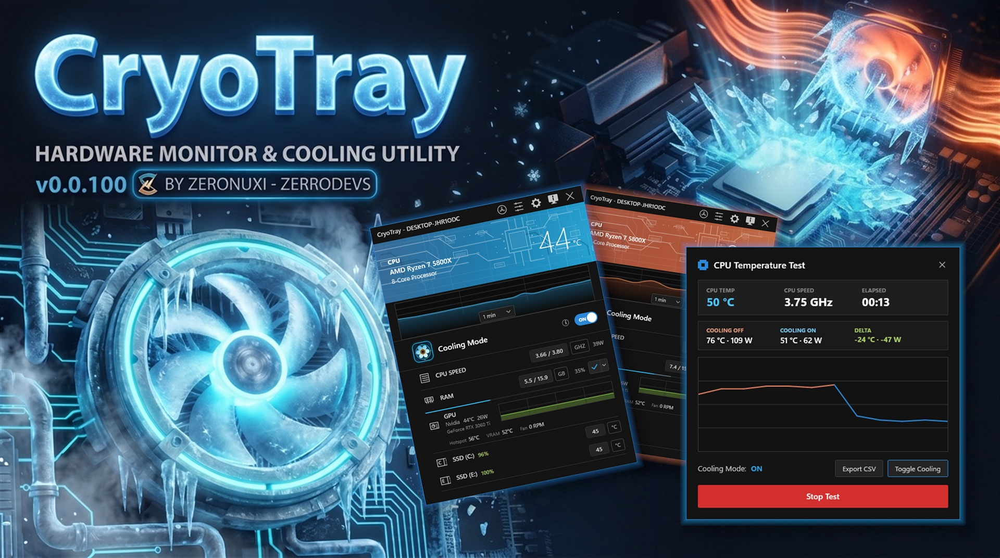

<p align="center">
  
</p>

<p align="center">
  
  
  
</p>

<p align="center">
  <strong>A native Windows system tray hardware monitor and low-heat CPU power utility, created by ZeroNuxi under ZerroDevs.</strong>
</p>

CryoTray keeps CPU, GPU, and storage temperatures visible without leaving a large monitoring window open. It combines a compact tray badge, an on-demand dashboard, a floating telemetry overlay, and a dedicated Windows power plan that lowers processor heat. Everything runs locally, with no account and no telemetry.

CryoTray does not control fans or voltages. Cooling Mode changes Windows processor power policy and is intended to reduce heat, not replace BIOS thermal protection.

## Contents

- [At a glance](#at-a-glance)
- [Feature tour](#feature-tour)
- [Cooling Mode](#cooling-mode)
- [Autopilot](#autopilot)
- [Tray behavior and alerts](#tray-behavior-and-alerts)
- [Floating overlay](#floating-overlay)
- [Utility windows](#utility-windows)
- [Settings reference](#settings-reference)
- [Install and run](#install-and-run)
- [Build from source](#build-from-source)
- [Testing and diagnostics](#testing-and-diagnostics)
- [Data, privacy, and updates](#data-privacy-and-updates)
- [Architecture](#architecture)
- [Project layout](#project-layout)
- [Limitations](#limitations)
- [Troubleshooting](#troubleshooting)
- [Security policy](#security-policy)
- [Contributing](#contributing)
- [License and attribution](#license-and-attribution)

## At a glance

| Item | Details |
| --- | --- |
| Platform | Windows 10 and Windows 11, x64 |
| Runtime | .NET 8 with WPF and Windows Forms |
| Privileges | Administrator, required by the application manifest for hardware sensor access |
| Sensor source | LibreHardwareMonitorLib 0.9.6, with WMI used only for system inventory |
| Sensor driver | PawnIO 2.x for low-level CPU and motherboard access |
| Tray badges | GPU, CPU, or one combined split badge |
| Cooling method | A dedicated `CryoTray Cooling` Windows power plan |
| Overlay | Optional always-on-top telemetry panel with selectable metrics |
| Appearance | **Dark** (default), **Light**, or **System**; shared by every window and the tray menu |
| Localization | English and Arabic, including right-to-left layouts |
| Storage | One JSON settings file under `%APPDATA%\CryoTray` |
| Network use | GitHub Releases update checks and downloads only |
| License | Apache License 2.0 |

## Feature tour

### Dashboard

The dashboard is a compact, custom-drawn window that opens above the notification area by default. It can also be positioned freely. It is dark by default, with **Light** and **System** appearance options under **Settings > View**, and it is created only when needed rather than staying resident in the background. All companion windows and the tray menu follow the same appearance.

The CPU section includes:

- A large hottest-core temperature readout with the current cooling accent.
- A hover bubble listing every mapped core as `CPU00`, `CPU01`, and so on.
- An underline on every core tied for the hottest reading.
- Current CPU clock speed (with optional nominal base speed toggle) and, when the processor exposes it, package power.
- A live CPU chart with 1, 5, 10, 30, and 60 minute timeframes, switchable between the full-width **Large** graph and a compact inline **Small** `CPU (AMD)` / `CPU (Intel)` row (or hidden).
- An animated six-petal cooling fan that spins faster in Cooling Mode and shifts from custom/default ice blue to copper with the active power plan.

The GPU section includes:

- Current GPU temperature and load.
- An inline GPU chart synchronized with the selected timeframe.
- GPU power, hotspot temperature, VRAM temperature, fan speed, and the GPU name when the hardware reports them.
- Per-readout visibility controls, so the row can stay compact.

The storage area lists detected storage drives with drive letters (`SSD (C:)` / `HDD (D:)`), badge letters inside the drive icon, inline SMART health percentages, and temperatures or optional per-drive live temperature graphs (`1` to `60` minute window). Hovering a drive shows its model, health, and status; individual drives can be hidden from **Settings > Disk**, or all storage rows can be toggled off via **Show SSD/HDD temperature**.

The RAM row shows live used and usable capacity, utilization percentage, a `2 px` real-time breakdown indicator (`In Use`, `Standby`, `Free`), an inline `Optimize RAM` split action button (with persisted working-set/modified and standby cleaning scopes), and a live-updating hover/click `Memory Breakdown` tooltip (`Installed`, `In Use`, `Available`, `Free`, `Standby`, `Modified`, `Cached`, `Hardware Reserved`, and session `Last freed`).

The dashboard also exposes optional Overlay and Autopilot rows, a Cooling Mode switch, and title-bar icons for Settings, System Information, and the CPU Temperature Test. The title icons use the cooling accent while their window is open and remain neutral when closed.

### Modeless utility windows

Settings, System Information, and CPU Temperature Test open as independent modeless windows. Opening one does not disable the dashboard, and the dashboard remains clickable. Clicking the same title icon again closes that utility. All three can be open at the same time.

Keyboard focus remains visible with an accent border. Mouse interaction does not leave the white focus outline that previously appeared around title-bar buttons.

### Monitoring without constant overhead

CryoTray polls hardware once per second and keeps a 60 minute ring buffer of CPU and GPU samples. Charts read from that buffer, so changing the timeframe does not trigger extra hardware reads. The dashboard and utility windows are created on demand, and the process trims its working set after windows close.

The application uses software rendering for predictable text and chart output across systems, including machines with limited or problematic GPU acceleration. Tray badge bitmaps and GDI resources are reused, and native icon handles are destroyed when replaced.

### Temperature alerts

CryoTray can raise a tray notification when the CPU, GPU, or a storage drive crosses its configured threshold. Each component has its own threshold:

- CPU: default 85 °C.
- GPU: default 80 °C.
- Storage: default 60 °C.

An alert fires once when a sensor crosses its threshold. The same sensor will not alert again for 10 minutes, and it must fall at least 3 °C below the threshold before it can re-arm. Notifications can be muted entirely, and Settings includes a test notification button.

Fan Health Watch is a separate optional notification. A fan header is armed only after spinning continuously above 300 RPM for one minute. If an armed fan then reports 0 RPM for 30 seconds while the CPU or GPU is under sustained load and at or above 60 °C, CryoTray shows a tray warning. Headers that never reported motion are ignored, state is cleared across sleep and resume with a 60 second grace period, and each fan has a 10 minute alert cooldown. The guard is deliberate: idle fan curves that stop fans at 0 RPM never arm the alert. Fan Health Watch is on by default and can be disabled under Settings > General.

System Information includes a live **Fan health** section under **Fan speeds**. It is collapsed by default; click the **Fan health** heading or its `>` chevron to open it. It lists every motherboard header and the primary GPU fan with current RPM, state (`Watching`, `Armed`, `Idle at 0 RPM`, or `Stopped`), arming or alert countdown, and the last alert time. **Hide idle fans** is on by default, hiding `Idle at 0 RPM` rows so active fans are not buried; `Stopped` rows always remain visible, and unchecking the filter shows every header. **Test fan notification** verifies the tray path. Clicking a fan alert opens System Information, expands the panel, and highlights that fan. Fan aliases set under **Settings > General > Fan names** appear in this panel, in fan alerts, and in copied diagnostics.

Storage health has its own optional watch. CryoTray notifies when a drive enters `Worn` or `Replace`, or when its SMART health falls by 10 points. Excluded drives are ignored, and each drive has a 10 minute cooldown. The toggle is under **Settings > Disk**.

All temperature displays, thresholds, charts, and notifications honor the selected Celsius or Fahrenheit unit.

### Updates

Settings > About checks the latest GitHub release and can download and install a newer build in place. Automatic checks are enabled by default and run at most once per day. Updates require the release's SHA-256 checksum to match; signed builds are also checked with Authenticode when a signature is available. Before installing, CryoTray saves the current version as a rollback point. If the new build does not work, About can restore the previous version.

## Cooling Mode

Cooling Mode activates a Windows power scheme named `CryoTray Cooling`. The scheme is embedded in the application as `Resources\CryoTray.pow` and imported automatically on first use when it is not already installed.

<p align="center">
  
  
</p>

<p align="center"><em>Cooling Mode on in ice blue, off in copper.</em></p>

The default Cooling Mode configuration:

- Processor Performance Boost Mode, `PERFBOOSTMODE`: disabled.
- Maximum Processor State, `PROCTHROTTLEMAX`: 99%.

Both values can be changed in Settings > CPU. The processor maximum can be set from 50% to 100%, and boost can be enabled when full performance is preferred. These values are applied to the CryoTray Cooling scheme, not to the normal power plan.

When Cooling Mode is off, CryoTray activates the configured normal power plan. Balanced is the default. Turning Cooling Mode on switches to the CryoTray plan; turning it off restores the normal plan. The active plan is synchronized every two seconds, so changes made through Windows' own power settings are reflected in the UI.

Cooling Mode is available from:

- The dashboard switch.
- The tray context menu.
- The CPU Temperature Test window.
- A configurable global hotkey supporting `Ctrl`, `Alt`, `Shift`, and `Win` plus `A-Z`, `0-9`, or `F1-F12`, disabled by default.
- The `Enable Cooling Mode on app launch` setting.

Because the application runs elevated, it can import and activate power schemes without an additional prompt after launch.

## Autopilot

Autopilot monitors running processes every 2.5 seconds using a single Win32 `CreateToolhelp32Snapshot` scan and can optionally watch for active fullscreen 3D or borderless games via `SHQueryUserNotificationState`. If a whitelisted app or a fullscreen game is active while Cooling Mode is on, Autopilot pauses Cooling Mode for full performance and restores it once clear.

Important behavior:

- Autopilot only pauses cooling that is already active. It does not turn Cooling Mode on by itself.
- Entries are stored by executable name, so a selected game can be matched regardless of its install path.
- Fullscreen auto-pause can be enabled from Settings > Autopilot independently of or alongside the whitelist.
- Foreground-only pause is available under Settings > Autopilot. When enabled, a whitelisted app pauses Cooling Mode only while it owns the foreground window, so a background launcher cannot keep Cooling Mode off after the game closes.
- Running applications can be picked from a list, or a portable executable can be added with the file browser.
- Removing an entry will not affect any process that is already running; the next poll updates the state.

Autopilot is useful for games that should not be limited by the low-heat processor settings. Users who never enable Cooling Mode do not need Autopilot.

## Tray behavior and alerts

The tray icon is the primary entry point:

- Left-click toggles the dashboard.
- Re-launching `CryoTray.exe` while it is already running signals the tray instance to open and focus the dashboard.
- Right-click opens the context menu.
- The menu provides Open Dashboard, Toggle Cooling Mode, **Pause Cooling Mode** (`15 minutes`, `30 minutes`, `1 hour`, and `Resume Cooling Now`), CPU Temperature Test, Click-Through Overlay, Settings, and Exit.
- Tooltips show CPU and GPU temperatures, plus the current cooling state or active pause countdown.

Badge options in Settings > View:

- Show the GPU badge in green.
- Show the CPU badge in coral when Cooling Mode is off and cyan when it is on.
- Choose temperature, load, or RAM percentage for the CPU and GPU badges independently. Temperature remains the default.
- Combine CPU and GPU temperatures into one split badge.
- Hide either individual badge.

Temperature alerts use the system tray balloon. Clicking a temperature alert opens the dashboard; an update notification opens Settings > About. Alerts are informational and do not change cooling settings.

The startup task is created through Windows Task Scheduler as `CryoTray` using Task 1.2 XML (`InteractiveToken`, `HighestAvailable`, 5 second logon delay, battery logon enabled, zero timeout limit, `/autostart` deduplication, and automatic executable path repair). Settings checks Task Scheduler status directly so any failure reverts cleanly instead of leaving the toggle out of sync. It is removed when `Launch app on PC startup` is disabled.

## Floating overlay

The floating overlay is a small always-on-top telemetry panel for use alongside games, benchmarks, or other full-window applications. Enable an Overlay row on the dashboard, then use that row to show or hide the panel. The overlay remembers its position between sessions.

Selectable metrics:

- CPU temperature, load, power, and clock speed.
- GPU temperature, load, and power.
- Optional RAM usage (used GB and percentage).
- Optional battery percentage and charging state on devices with a battery. Desktop systems hide both the metric and its setting.

The overlay groups CPU, GPU, RAM, and battery metrics separately and hides empty groups automatically. If every metric is disabled, it shows `No metrics selected` instead of an empty panel. Opacity is adjustable from 0% to 100%; at 0% the background becomes fully transparent while the text remains visible.

When **Click-through overlay** is enabled (`WS_EX_TRANSPARENT`), mouse clicks pass directly to games and windows underneath and the close button is hidden. You can disable click-through from Settings > View or the system tray context menu. Otherwise, the overlay can be dragged by its surface and closed with its close button. Exclusive fullscreen applications may cover desktop overlays; borderless windowed mode generally works better.

## Utility windows

### CPU Temperature Test

The CPU Temperature Test is a controlled load test:

- Starts worker loops on every logical processor.
- Shows live CPU temperature, clock speed, and elapsed time.
- Charts the last 60 temperature samples (copper when Cooling Mode is off, ice blue when on) and records full run telemetry for **Export CSV** (`TelemetryCsvService`).
- Compares stabilized **Cooling OFF vs Cooling ON** temperature and CPU wattage in real time to display exact `-°C · -W` reductions.
- Counts stress-loop iterations per second in each phase and shows `Performance retained: 93%` next to the temperature and wattage delta.
- Projects that percentage onto a selectable 60/100/120/144/165/240 FPS reference (100 by default) using the preset dropdown under the estimate (`If 144 FPS: ~121 FPS (23 lost)`); the choice is saved, and the line updates immediately. A tooltip notes that actual loss may be less or more depending on the game, GPU limits, thread usage, and frame pacing, and that the estimate assumes a CPU-bound game.
- Allows Cooling Mode to be toggled while the test is running.
- Stops all workers when the test is stopped or the window closes.

This is a system stress test. Do not run it on a machine with inadequate cooling, and do not treat it as a substitute for hardware diagnostics. The window is modeless, so the dashboard remains usable while it runs.

### System Information

System Information reads the machine inventory when the window opens and refreshes the uptime every second. It reports:

- Computer name.
- Processor model and core count.
- Installed memory.
- Graphics card.
- Storage devices, capacity, health, and free space.
- Operating system.
- Windows uptime.
- Startup speed from the Windows event log.
- CPU temperature minimum, average, and peak from the current telemetry history.
- Read-only motherboard fan speeds (CPU, chassis, and other headers the sensor driver reports). Headers reading 0 RPM are hidden, and `--` appears when no fan is moving.
- A live Fan health section with per-fan state, last alert time, the primary GPU fan, a test notification button, and an optional **Hide idle fans** filter that always keeps stopped fans visible.
- Connected monitors and network interfaces.
- System errors, including the BSOD count available from the event log.

`Save to...` writes a plain-text system report. **Copy** copies a shorter diagnostics snapshot containing the app version, CPU, GPU, temperatures, RAM, fan states, and drive health. Copied diagnostics omit serial numbers, PC names, and file paths. Missing values from unsupported hardware or unavailable WMI providers are shown as unknown or not reported instead of failing the window.

### Settings

Settings opens as a modeless companion window and includes eight tabs: General, View, CPU, Memory, Disk, GPU, Autopilot, and About. The footer can export all settings to JSON, import them back, or reset them to defaults. Changes apply immediately and are saved to disk.

## Settings reference

### General

| Setting | Effect |
| --- | --- |
| Language | Switches all windows between English and Arabic, including right-to-left layout |
| Temperature units | Celsius or Fahrenheit for readouts, charts, thresholds, and alerts |
| Mute temperature alerts | Suppresses CPU, GPU, and drive notifications |
| Warn when a running fan stops | Enables Fan Health Watch for armed fans that stop under sustained load (enabled by default) |
| Fan names | Renames motherboard and GPU fan headers for the panel, fan alerts, and diagnostics; leave a field blank to use the sensor name |
| Send test notification | Verifies that tray notifications are visible |
| Show computer name | Adds the PC name to the dashboard title area |
| Launch app on PC startup | Creates or removes the `CryoTray` Task Scheduler entry |
| Launch app in background mode | Starts without opening the dashboard |
| Enable Cooling Mode on app launch | Activates the cooling plan at startup |
| Auto-enable Cooling Mode on battery | Switches to Cooling Mode when AC power disconnects and restores the normal plan when plugged back in |
| Disable Cooling Mode on closing the app | When Cooling Mode is on, prompts before exit and switches to the normal power plan; enabled by default |
| Pin window to taskbar | Controls whether the dashboard appears in the taskbar |
| Always on top | Keeps the dashboard above other windows |
| Hide on focus loss | Hides the dashboard when it loses focus, unless Always on top is enabled |
| Use a key combo | Enables the custom cooling hotkey supporting `Ctrl`, `Alt`, `Shift`, `Win` plus `A-Z`, `0-9`, or `F1-F12` with conflict detection |
| Automatic update checks | Checks GitHub Releases at most once per day |

### View

| Setting | Effect |
| --- | --- |
| Theme | **Dark** (default), **Light**, or **System**; System follows the Windows app theme and updates live |
| Show GPU temperature in tray | Shows the green GPU tray badge with **Black digits** (default) or **White digits** and live preview badges |
| Show CPU temperature in tray | Shows the coral/cyan CPU tray badge with **Black digits** (default) or **White digits** and live preview badges |
| Combine tray icons | Replaces separate badges with one split CPU/GPU badge honoring both digit palettes |
| Window Frame Colors | Customizes the border/accent frame colors for `"Cooling ON"` mode (`#2B88D8` default) and `"Cooling OFF"` mode (`#C26A47` default) with reset buttons |
| Anchor dashboard to tray | Positions the dashboard above the notification area |
| Show RAM usage row | Displays zero-WMI physical memory usage (`GlobalMemoryStatusEx`) on the dashboard |
| Show Overlay row | Adds the overlay control row to the dashboard |
| Show Autopilot row | Adds the Autopilot control row to the dashboard |
| Click-through overlay | Sets `WS_EX_TRANSPARENT` so mouse clicks pass through the floating overlay |
| Overlay readouts | Selects CPU, GPU, optional RAM, and battery metrics for the floating panel |
| Show battery percentage | Adds charge level and charging state to the overlay and tray tooltip; hidden on systems without a battery |
| Overlay opacity | Sets the overlay background transparency from 0% to 100% |
| Dashboard readouts | Controls CPU power and GPU power, temperature, name, hotspot, VRAM, and fan visibility |
| CPU / GPU badge value | Shows temperature, load, or RAM percentage in each tray badge (temperature by default) |
| Show motherboard fan speeds | Adds the read-only fan RPM row and Fan health section to System Information (enabled by default) |

### CPU

| Setting | Effect |
| --- | --- |
| Show CPU clock speed | Shows or hides the dashboard CPU clock speed row (with **Show base speed**, enabled by default) |
| Show CPU temperature graph | Shows or hides the dashboard CPU chart, selects timeframe (`1/5/10/30/60 min`), and chooses **Large** (default) or **Small** inline layout |
| Power plan when cooling is off | Selects the plan restored when Cooling Mode is disabled |
| Processor Performance Boost Mode | Disables boost for lower heat or enables aggressive boost |
| Maximum Processor State | Sets the processor limit used by the cooling scheme, from 50% to 100% |
| High temperature alert threshold | Sets the CPU threshold from 60 °C to 100 °C |

### Memory

| Setting | Effect |
| --- | --- |
| Cleaning options | Enables or disables trimming working sets and flushing modified pages (`MemoryEmptyWorkingSets` + `MemoryFlushModifiedList`), purging standby cache (`MemoryPurgeStandbyList`), clearing the clipboard, and showing freed-memory tray notifications |
| Enable Auto RAM Optimization | Automatically cleans memory when available RAM drops below the configured threshold (10% to 50%, 5-minute cooldown) or on a periodic schedule (1h to 6h) |
| CPU idle guard | Checks real CPU utilization via `GetSystemTimes` over 1 second before running auto-optimization so cleanup never interrupts active games or heavy work (`< 10%` usage required) |
| Global RAM shortcut | Configures a custom hotkey (default `Ctrl + Alt + M`) via `RegisterHotKey` to optimize memory immediately from anywhere |

### Disk and GPU

The Disk tab includes a master **Show SSD/HDD temperature** toggle, an optional **Warn when drive health drops** watch, a storage alert threshold (40 °C to 85 °C), and per-drive checkboxes (`ExcludedDrives`) to hide them or enable per-drive **Show SSD graph** / **Show HDD graph** inline charts with individual `1` to `60` minute timeframes (`DiskGraphDrives`, `DiskGraphTimeframes`). The GPU tab lets you choose the Primary GPU (defaulting to Auto, which prioritizes discrete graphics) and sets the graphics alert threshold, from 50 °C to 95 °C. Sensors that are missing or blocked by an uninstalled PawnIO driver display `--` or an unavailable notice instead of synthetic fallback values, and drives without a valid temperature sensor are skipped for alerts.

### Autopilot

Enable Autopilot, toggle automatic pause during fullscreen 3D games and apps, choose a running application, or browse to an executable. The optional **Pause only while a whitelisted app is in the foreground** checkbox restricts the whitelist match to the current foreground process, so background launchers do not pause Cooling Mode on their own. The whitelist and both pause preferences are saved with the rest of the settings. Entries can be removed individually.

### About

The About tab shows the installed version, update status, automatic update option, manual update button, rollback button when a backup exists, copyright and license details, and a link to the repository.

## Install and run

### Prebuilt release

1. Open [GitHub Releases](https://github.com/ZerroDevs/CryoTray/releases) and download either `CryoTray-Setup-<version>.exe` (recommended installer with bundled PawnIO setup and clean power-plan uninstall cleanup) or the portable `CryoTray-<version>-win-x64.zip`.
2. Download the matching `.sha256` file.
3. Verify the file before installing or extracting:

   ```powershell
   Get-FileHash .\CryoTray-Setup-<version>.exe -Algorithm SHA256
   ```

   The hash must match the value in the checksum file.
4. For the portable zip, extract the archive to a writable folder. It includes `PawnIO_setup.exe`; run it if PawnIO 2.x is not already installed, then run `CryoTray.exe` (approving UAC). The installer runs silent PawnIO setup automatically when missing.

The release package is self-contained for win-x64, so a separate .NET runtime installation is not required.

PawnIO is required for CPU temperature and other low-level sensors. Without it, CryoTray still starts, but unsupported sensors may show no data or an unavailable value.

### Requirements

- Windows 10 or Windows 11, x64.
- Administrator privileges, required by the application manifest.
- PawnIO 2.x for full sensor coverage.
- Internet access only for update checks and downloads.

### First run

The dashboard opens unless `Launch app in background mode` is enabled. Hiding the dashboard leaves the tray icon running. Use Exit from the tray menu to stop the application and release its hardware handles and power-plan monitoring.

## Build from source

### Prerequisites

- [.NET 8.0 SDK](https://dotnet.microsoft.com/download/dotnet/8.0).
- Windows 10 or Windows 11, x64.
- Visual Studio is optional; the repository builds with the .NET CLI.
- PawnIO 2.x for running the sensor-dependent parts of the runtime tests.

### Build

```powershell
dotnet restore CryoTray.csproj
dotnet build CryoTray.csproj -c Release
```

The executable is written to:

```text
bin\Release\net8.0-windows\CryoTray.exe
```

Run it from an elevated terminal, or launch it normally and approve the UAC prompt:

```powershell
Start-Process .\bin\Release\net8.0-windows\CryoTray.exe
```

### Local publish

The release workflow produces a self-contained win-x64 folder, an Inno Setup installer, and a portable zip (`build-installer.ps1`):

```powershell
dotnet publish CryoTray.csproj `
  -c Release `
  -r win-x64 `
  --self-contained true `
  -p:PublishSingleFile=false `
  -p:DebugType=None `
  -o publish\win-x64
```

Copy the whole `publish\win-x64` folder, or run `.\build-installer.ps1` to generate both `Installer\Output\CryoTray-Setup-<version>.exe` and `release\CryoTray-<version>-win-x64.zip`. The portable zip includes `PawnIO_setup.exe` at its root. Stop any running CryoTray instance first so the Release output is not locked.

### Versioning and releases

The version is stored in the `VERSION` file as three numeric parts. The project reads that value into the assembly and file version. Pushing a change to `VERSION` on `main`, or running the Release workflow manually, triggers `.github/workflows/release.yml`. The workflow:

1. Builds the Release binary and runs the `/test` verification suite.
2. Publishes the self-contained `publish\win-x64` payload and compiles `Installer\CryoTray.iss` into `CryoTray-Setup-<version>.exe`.
3. Signs both `CryoTray.exe` and `CryoTray-Setup-<version>.exe` when repository signing secrets are configured.
4. Creates checksummed release assets (`CryoTray-Setup-<version>.exe`, `CryoTray-<version>-win-x64.zip`, and their `.sha256` files) and publishes a GitHub release unless that tag already exists.

## Testing and diagnostics

### Runtime verification suite

The executable includes an integration test harness:

```powershell
dotnet .\bin\Release\net8.0-windows\CryoTray.dll /test
```

Run it elevated for full sensor coverage. The 38 checks cover ring buffer stats, `CryoTray Cooling` power-plan lifecycle and uninstall cleanup, WMI/EDID system queries, GDI icon handle cleanup, English and Arabic RTL localization, theme persistence and normalization, all five WPF windows, per-core temperature mapping and honest `NaN` fallback safety, alert cooldown and drive exclusion filtering, fan health arming, GPU fan and idle-stop guards, storage health transitions and cooldowns, tray badge metric resolution, foreground-only Autopilot matching, multi-GPU selection, PawnIO detection, overlay `WS_EX_TRANSPARENT` click-through, custom hotkey capture/registration, `Toolhelp32` process scan and fullscreen state, `EventWaitHandle` activation signaling, `GlobalMemoryStatusEx` + NT page-list RAM breakdown (`NtQuerySystemInformation(80)`), dynamic byte formatting, `GetSystemTimes` CPU-idle math, kernel memory optimization (`NtSetSystemInformation`) and privilege fallback, RAM tooltip hover/pin lifecycle, `TelemetryCsvService` export, `StartupTaskService` XML & elevated Task Scheduler sync, dashboard SSD drive-letter labels, timed Cooling Mode pause/resume, stress-test Cooling OFF vs ON delta, retained-throughput, and FPS-impact calculations, dark owner-drawn tray context menu rendering, custom Cooling ON/OFF frame colors, Black vs White tray badge digit rendering, CPU clock/base-speed formatting, Small/Large CPU graph layouts, per-drive inline temperature history lookup, zero-hardcoding hardware vendor/snapshot clone integrity, and dark WPF `ToolsContextMenu` / `RamScopeMenu` rendering without white icon gutters.

This is not an isolated unit test suite. It reads real hardware, creates or modifies the `CryoTray Cooling` power plan, resets that scheme's stored parameters, and may require multiple CPU cores. Use it on a test machine or accept that it touches those system settings.

### CPU sensor dump

For diagnosing missing or incorrect CPU readings:

```powershell
dotnet .\bin\Release\net8.0-windows\CryoTray.dll /dump
```

Run it elevated. It opens a CPU-only LibreHardwareMonitor session and writes every temperature and clock sensor, including type, value, minimum, maximum, and identifier, to `cpu-sensors.txt`.

### Build verification used by this repository

```powershell
dotnet build CryoTray.csproj -c Release -o build-check -p:UseSharedCompilation=false
```

This builds the application into a separate output folder, which is useful when the normal Release executable is running.

## Data, privacy, and updates

CryoTray does not include analytics, advertising, accounts, or remote telemetry. Hardware readings stay on the machine.

Local files:

- `%APPDATA%\CryoTray\settings.json`: all application settings, including window positions and the Autopilot whitelist.
- `%APPDATA%\CryoTray\crash.log`: unhandled exception details, when one is captured.

Update checks contact the GitHub Releases API:

```text
https://api.github.com/repos/ZerroDevs/CryoTray/releases/latest
```

Automatic checks occur at most once per day when enabled. A downloaded update is verified against the release's SHA-256 checksum. If an Authenticode signature is present, it is verified before installation. The updater stores a backup of the previous installation in its working area, and Settings > About offers to restore it.

No setting, sensor log, machine name, or usage data is sent to the update service. Only the standard HTTP request needed to fetch the latest release is made.

## Architecture

CryoTray is a single WPF process with a lightweight tray shell. Hardware polling runs in the background once per second, while UI work stays on the WPF dispatcher. System inventory queries are deferred until System Information is opened.

```text
CryoTray.exe
├── App.xaml.cs
│   ├── single-instance mutex and EventWaitHandle activation
│   ├── tray manager and dashboard lifecycle
│   ├── global hotkey registration and battery power rule
│   ├── temperature alert routing
│   └── automatic update scheduling and /uninstall-cleanup
├── HardwareMonitorService
│   ├── LibreHardwareMonitor CPU, GPU, and storage polling
│   ├── kernel RAM telemetry delegation
│   ├── CPU core temperature mapping
│   └── 3,600-sample telemetry ring buffer
├── MemoryTelemetryService & MemoryOptimizerService
│   ├── GetPhysicallyInstalledSystemMemory, GlobalMemoryStatusEx, and NtQuerySystemInformation(80)
│   ├── background NtSetSystemInformation(80) cleanup with SeProfileSingleProcessPrivilege
│   └── GetSystemTimes CPU-idle guarded auto-optimization and threshold cooldowns
├── TelemetryCsvService
│   └── ring-buffer export and continuous 1 Hz CSV recording
├── PowerPlanService
│   ├── CryoTray Cooling scheme import and uninstall cleanup
│   ├── active power-plan switching
│   └── PERFBOOSTMODE / PROCTHROTTLEMAX updates
├── AutopilotService
│   ├── CreateToolhelp32Snapshot process whitelist polling every 2.5 seconds
│   └── SHQueryUserNotificationState fullscreen 3D auto-pause
├── TemperatureAlertService
│   ├── per-component thresholds
│   └── 10 minute cooldown and 3 °C re-arm hysteresis
├── FanHealthService & StorageHealthAlertService
│   └── fan-stop and SMART health watchdogs
├── BatteryTelemetryService
│   └── PowerStatus battery percentage and charging state
├── ThemeService
│   └── Dark / Light / System palette and Windows theme tracking
├── SystemInfoQueryService
│   └── on-demand WMI, display, network, and event-log reads
├── TrayIconManager
│   └── cached badge rendering and native icon cleanup
└── Views
    ├── MainWindow
    ├── SettingsWindow
    ├── SystemInfoWindow
    ├── StressTestWindow
    ├── OverlayWindow
    └── ConfirmExitWindow
```

Key implementation choices:

- **Software rendering.** WPF renders in software to keep text and charts consistent across systems.
- **On-demand windows.** Companion windows are constructed per open and released on close where practical.
- **Cached telemetry.** The ring buffer holds 3,600 one-second samples, enough for the 60 minute chart range.
- **Resource ownership.** GDI objects and HICON handles are retained only as long as needed and destroyed when a badge is replaced or disposed.
- **Localization resources.** English and Arabic strings live in XAML resource dictionaries, and the application reapplies localization when the language changes.
- **Theme resources.** Shared brushes in `App.xaml` are swapped at runtime by `ThemeService`; dark is the default, light is a full warm-neutral palette, and System follows the Windows app theme.
- **Power-plan fallback.** The embedded `.pow` file is imported through `powercfg`; existing schemes are reused by name.
- **Single instance.** A named mutex prevents duplicate tray instances.

## Project layout

```text
CryoTray.csproj              .NET 8 WPF/WinForms project and package metadata
App.xaml / App.xaml.cs       application lifecycle and orchestration
VERSION                      release version, consumed by MSBuild
LICENSE                      Apache License 2.0
NOTICE                       attribution and redistribution notice
app.manifest                 administrator privilege and DPI settings
Models/                      settings, telemetry snapshots, and system info models
Services/                    hardware, power, settings, updates, alerts, localization
Tray/                        tray icons, badge rendering, and context menu
Views/                       dashboard, settings, overlay, stress test, system info
Images/                      banner, logo, application icon, and state artwork
Resources/                   XAML strings, theme resources, embedded power scheme
Tests/                       runtime verification and CPU sensor diagnostics
.github/workflows/           Windows release packaging and GitHub release publication
```

## Limitations

- **Windows only.** The implementation depends on WPF, Windows Forms, WMI, Task Scheduler, and Windows power-management APIs.
- **Administrator access is required.** Hardware sensor access and power-plan changes need elevation.
- **Sensor coverage varies by hardware.** Some processors, GPUs, and drives expose only a subset of the values shown in the UI. Missing cells and unavailable states are expected on unsupported sensors.
- **No fan or voltage control.** Cooling Mode is a Windows processor power policy. It does not issue fan commands, undervolt the CPU, or alter BIOS settings.
- **Per-core temperatures may not be available.** When a CPU exposes only a package or CCD sensor, CryoTray distributes the available reading across the reported cores for display. The hottest reading remains the authoritative sensor value.
- **Overlay limitations.** Exclusive fullscreen applications can cover any topmost desktop overlay. The overlay is not designed to be a game cheat overlay or to inject into another process.
- **Power settings have system-wide effects.** Enabling Cooling Mode changes the active Windows power scheme. Review the selected normal plan before relying on it for battery life or performance.
- **Stress testing is real load.** The CPU Temperature Test spins work on every logical processor. Use it responsibly and monitor temperatures.

## Troubleshooting

| Problem | What to check |
| --- | --- |
| CPU temperature is missing or zero | Confirm PawnIO 2.x is installed and rebooted, approve UAC, and run `/dump` from an elevated terminal to see which sensors are exposed |
| Tray badges are missing | Enable the desired badge in Settings > View; check the Windows notification-area overflow menu |
| Tray temperatures do not update | Make sure the dashboard or tray shell is running and that a supported sensor reports a positive temperature |
| Dashboard disappears when clicking elsewhere | Disable `Hide on focus loss`, or enable `Always on top` |
| Hotkey does nothing | Enable the hotkey, record a shortcut in Settings > General, and watch for any conflict warning shown below the box |
| Cooling Mode does not change | Run the app elevated and confirm `CryoTray Cooling` appears in Windows power settings; the app recreates the scheme if it was removed |
| Autopilot does not pause cooling | Confirm Cooling Mode is on, Autopilot is enabled, and the executable name is on the whitelist |
| Overlay is invisible in a game | Use borderless windowed mode; exclusive fullscreen can cover desktop overlays |
| Overlay is empty | Select at least one CPU or GPU metric in Settings > View |
| Update check fails | Verify internet access to GitHub, then try again; releases must include a valid version and downloadable asset |
| Update download is rejected | Check that the `.sha256` asset is present and matches the downloaded archive |
| Arabic layout looks wrong | Switch back to English and then Arabic to force a full localization refresh, and report the affected window |

Crash information is appended to `%APPDATA%\CryoTray\crash.log`. Include the log and an exported system report when reporting a reproducible problem.

## Security policy

CryoTray takes security seriously. If you find a security vulnerability, please report it privately through GitHub Private Vulnerability Reporting or by emailing the maintainer directly. See our [Security Policy](SECURITY.md) for full details, SLA, and supported versions.

## Contributing

Contributions, bug reports, and hardware compatibility findings are welcome. Please read our [Contributing Guide](CONTRIBUTING.md) for architectural guidelines, the 1-second telemetry budget, GDI resource hygiene, RTL localization, and testing requirements before submitting a pull request. Useful reports include:

- Windows version and build.
- CPU, GPU, and storage models.
- Whether PawnIO is installed.
- Steps to reproduce the issue.
- The relevant application log or an exported System Information report.

Please keep changes consistent with the existing theme resources (Dark default plus Light and System), the one-second telemetry budget, English/Arabic resource dictionaries, and the existing WPF/WinForms stack.

## License and attribution

CryoTray is licensed under the [Apache License, Version 2.0](LICENSE). See [NOTICE](NOTICE) for attribution and redistribution requirements.

Copyright 2026 ZeroNuxi - ZerroDevs.

The application was created by ZeroNuxi under the ZerroDevs organization. Redistributions and derivative works must retain the attribution notice in [NOTICE](NOTICE).
